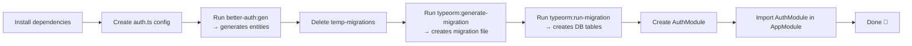

# Better Auth + TypeORM Integration in NestJS

This document explains step-by-step how we integrated [Better Auth](https://www.better-auth.com/) with [TypeORM](https://typeorm.io/) inside a [NestJS](https://nestjs.com/) application.

---

## 1. Install Dependencies

We need three packages:

| Package | Purpose |
|---|---|
| `better-auth` | The core authentication library |
| `@hedystia/better-auth-typeorm` | TypeORM adapter for Better Auth (entity generation + runtime queries) |
| `@thallesp/nestjs-better-auth` | NestJS wrapper that mounts Better Auth as a NestJS module with its own controller |

```bash
npm install better-auth @hedystia/better-auth-typeorm @thallesp/nestjs-better-auth
```

---

## 2. Create the Auth Configuration File

The heart of the integration is `src/modules/auth/auth.ts`. It exports two things:

- **`getAuth(dataSource)`** – A factory function that receives a NestJS-managed `DataSource` at runtime.
- **`auth`** – A default instance pre-configured with a **CLI-only** `DataSource` (pointing to your local Docker database). This is used exclusively by the Better Auth CLI.

```ts
// src/modules/auth/auth.ts
import { betterAuth } from 'better-auth';
import { typeormAdapter } from '@hedystia/better-auth-typeorm';
import { DataSource } from 'typeorm';
import { bearer } from 'better-auth/plugins';

// CLI-only DataSource — keeps Better Auth CLI working without a running NestJS app
const cliDataSource = new DataSource({
    type: 'postgres',
    host: 'localhost',
    port: 5433,
    username: 'postgres-docker',
    password: 'postgres-docker',
    database: 'ultimate-nestjs',
});

export const getAuth = (dataSource: DataSource) => {
    return betterAuth({
        plugins: [bearer()],
        baseURL: process.env.BETTER_AUTH_URL,
        secret: process.env.BETTER_AUTH_SECRET,
        emailAndPassword: { enabled: true },
        session: {
            expiresIn: 60 * 60 * 24 * 7,          // 7 days
            updateAge: 60 * 60 * 24,               // 1 day
            cookieCache: {
                enabled: true,
                maxAge: 5 * 60,                    // 5 minutes
                strategy: 'jwt',
            },
        },
        database: typeormAdapter(dataSource as any, {
            outputDir: './src/modules/auth',
            entitiesDir: './src/modules/auth/entities',
            migrationsDir: './src/modules/auth/temp-migrations',
        }),
    });
};

export const auth = getAuth(cliDataSource);
```

### Key details

- **`typeormAdapter` accepts an `outputDir` / `entitiesDir` / `migrationsDir`** — these tell the CLI where to write generated entity files and temporary migration files.
- The **bearer plugin** enables token-based authentication via the `Authorization: Bearer <token>` header.
- **Session caching** is configured with JWT strategy to reduce database lookups on every request.

---

## 3. Generate Entities from `auth.ts`

Better Auth ships a CLI that reads your configuration and **auto-generates TypeORM entities**.

```bash
npm run better-auth:gen
```

This is defined in `package.json` as:

```json
"better-auth:gen": "npx auth generate --config ./src/modules/auth/auth.ts"
```

The command produces:

- **4 entity files** inside `src/modules/auth/entities/`:
  - `user.entity.ts` — stores user profiles (name, email, email verification status, image)
  - `session.entity.ts` — stores user sessions with expiry, token, and device info
  - `account.entity.ts` — stores OAuth/provider accounts linked to a user (supports social login & password-based accounts)
  - `verification.entity.ts` — stores email verification codes

- **Temporary migration files** inside `src/modules/auth/temp-migrations/` (we delete these — see step 4).

### Entity relationships

```
User (1) ──< (N) Session
User (1) ──< (N) Account
```

Both `Session` and `Account` declare a `@ManyToOne` relation to `User` with `ON DELETE CASCADE`.

---

## 4. Remove Auto-Generated Migrations

Better Auth's CLI generates its own migration files in `src/modules/auth/temp-migrations/`. We **delete them** because:

- We want **full control** over the migration lifecycle via TypeORM's own migration pipeline.
- We prefer a single, clean migration file alongside our other schema migrations.

So after generation:

```bash
rm -rf src/modules/auth/temp-migrations
```

---

## 5. Generate a TypeORM Migration

With the entities ready, we ask TypeORM to diff the current database schema (empty) against the entity definitions and produce a migration file.

```bash
npm run typeorm:generate-migration --name=add_better_auth
```

This runs:

```bash
ts-node ./node_modules/typeorm/cli migration:generate \
  -d ./typeorm/typeorm.config.ts \
  ./typeorm/migrations/add_better_auth
```

TypeORM connects using the config in `typeorm/typeorm.config.ts`:

```ts
export default new DataSource({
    type: 'postgres',
    host: 'localhost',
    port: 5433,
    username: 'postgres-docker',
    password: 'postgres-docker',
    database: 'ultimate-nestjs',
    migrations: ['typeorm/migrations/**'],
    entities: ['src/**/*.entity.ts'],
});
```

The result is `typeorm/migrations/1784709400746-add_better_auth.ts`, which contains `CREATE TABLE` / `CREATE INDEX` / `ALTER TABLE ADD CONSTRAINT` statements for all four tables (`user`, `session`, `account`, `verification`).

---

## 6. Run the Migration

Apply the migration to your database:

```bash
npm run typeorm:run-migration
```

This executes `typeorm/migrations/<timestamp>-add_better_auth.ts` against your PostgreSQL instance, creating the four tables with proper indexes and foreign keys.

---

## 7. Create the AuthModule

The NestJS module wires everything together at runtime.

```ts
// src/modules/auth/auth.module.ts
import { Module } from '@nestjs/common';
import { AuthModule as BetterAuthModule } from '@thallesp/nestjs-better-auth';
import { DataSource } from 'typeorm';
import { getAuth } from './auth';
import { PostgresqlModule } from '../db/postgresql/postgresql.module';

@Module({
    imports: [
        BetterAuthModule.forRootAsync({
            imports: [PostgresqlModule],
            inject: [DataSource],
            useFactory: (dataSource: DataSource) => {
                return {
                    auth: getAuth(dataSource),
                    path: '/api/auth',
                };
            },
        }),
    ],
    exports: [BetterAuthModule],
})
export class AuthModule {}
```

### How it works

1. **`PostgresqlModule`** is imported — it configures `TypeOrmModule.forRootAsync()` and **exports `TypeOrmModule`**, which makes the `DataSource` provider available globally.
2. **`inject: [DataSource]`** pulls the active TypeORM connection that NestJS already manages.
3. **`getAuth(dataSource)`** creates a Better Auth instance using the **runtime** `DataSource` (not the CLI one).
4. **`path: '/api/auth'`** mounts all Better Auth routes (sign-up, sign-in, sign-out, session verification, etc.) under `/api/auth/*`.

### Register in AppModule

Finally, `AuthModule` is imported in `AppModule.forRoot()`:

```ts
@Module({ ... })
export class AppModule {
    static forRoot(env: Environment): DynamicModule {
        return {
            module: AppModule,
            imports: [
                // ... other modules
                AuthModule,
                PostgresqlModule,
                // ...
            ],
        };
    }
}
```

---

## Runtime Architecture

```
┌─────────────────────────────────────────────────────────┐
│                    NestJS Application                    │
│                                                          │
│  ┌──────────────┐    ┌───────────────────────────────┐  │
│  │  AuthModule   │    │       PostgresqlModule        │  │
│  │  (BetterAuth  │◄───│  (TypeOrmModule.forRootAsync) │  │
│  │   Module)     │    │                               │  │
│  │              │    │  Exports: DataSource           │  │
│  │  path:       │    └──────────┬────────────────────┘  │
│  │  /api/auth/* │               │                       │
│  └──────┬───────┘               │                       │
│         │                       │                       │
│         │  getAuth(dataSource)  │                       │
│         ▼                       ▼                       │
│  ┌──────────────────────────────────────────────────┐   │
│  │             Better Auth Runtime                    │   │
│  │  ┌─────────────────────────────────────────────┐  │   │
│  │  │        typeormAdapter(dataSource)            │  │   │
│  │  │         → Query entities at runtime          │  │   │
│  │  └─────────────────────────────────────────────┘  │   │
│  └──────────────────────────────────────────────────┘   │
└─────────────────────────────────────────────────────────┘
```

---

## Environment Variables

The following variables must be set in your `.env` file:

| Variable | Description |
|---|---|
| `BETTER_AUTH_URL` | The base URL of your app (e.g. `http://localhost:4001`) |
| `BETTER_AUTH_SECRET` | A secret key used to sign tokens. Generate with `openssl rand -hex 32` |

---

## Summary of the Full Workflow



### Useful Commands

```bash
# Generate/update entities from auth config
npm run better-auth:gen

# Generate a new TypeORM migration (after entity changes)
npm run typeorm:generate-migration --name=describe_change

# Run pending migrations
npm run typeorm:run-migration

# Revert the last migration
npm run typeorm:revert-migration
```
